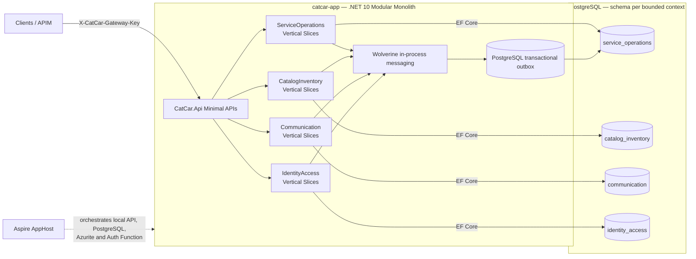

# CatCar App

Back-end modular monolith for a car repair shop management system — work orders, customers, vehicles, budgets, cataloged services, parts/inventory control, and customer authentication.

## Multi-Repository Architecture (Academic Cloud Consolidation)

Under the academic cloud consolidation model, the CatCar ecosystem decouples domain applications, serverless authentication, and cloud infrastructure into specialized repositories under [`RiseOn-CatCar`](https://github.com/RiseOn-CatCar):

| Repository | Description | CI/CD & Deploy |
|---|---|---|
| [**`catcar-app`**](https://github.com/RiseOn-CatCar/catcar-app) | Main .NET 10 Modular Monolith, Aspire AppHost & test suite | AKS Workloads via Aspire/Helm (Production tag `v*.*.*`) |
| [**`catcar-auth-function`**](https://github.com/RiseOn-CatCar/catcar-auth-function) | Serverless Azure Function (.NET 10 Isolated) for customer CPF auth & JWT | Azure Function Flex Consumption |
| [**`catcar-kubernetes-infra`**](https://github.com/RiseOn-CatCar/catcar-kubernetes-infra) | Terraform IaC: AKS (Free, 1-2 nodes), ACR (Basic), APIM (Consumption), VNet & Alerts | Terraform automated apply |
| [**`catcar-database-infra`**](https://github.com/RiseOn-CatCar/catcar-database-infra) | Terraform IaC: Azure PostgreSQL Flexible Server (17 B1ms), Key Vault & Private DNS | Terraform automated apply |

### Key Architectural Patterns
- **DDD** with 4 Bounded Contexts: ServiceOperations, CatalogInventory, Communication, IdentityAccess
- **Vertical Slice Architecture** within each Bounded Context
- **Wolverine** for in-process messaging with PostgreSQL outbox
- **EF Core** with schema-per-BC, UUID v7, optimistic concurrency via `xmin`
- **RiseOn.AutoInject** for automatic service registration
- **RiseOn.ResultRail** for the Result pattern (`Upshot<T>`)
- **Origin Ingress Protection**: APIM injects `X-CatCar-Gateway-Key` header; `Program.cs` rejects POST requests missing or carrying an invalid key with HTTP 403 in Production.
- **.NET Aspire Orchestration**: Dual-mode AppHost for unified local development (`make dev`) and production deployment.

## Dedicated Modular Monolith Architecture



The contexts retain independent domain models and EF Core schemas; vertical slices expose use cases without introducing cross-context data access. Wolverine persists integration messages in the same PostgreSQL transaction through the outbox before asynchronous delivery.

## Prerequisites

- [.NET 10 SDK](https://dotnet.microsoft.com/download/dotnet/10.0)
- [Docker](https://www.docker.com/products/docker-desktop)
- [Azure Functions Core Tools v4.14.0+](https://learn.microsoft.com/azure/azure-functions/functions-run-local) (for local Function execution in Development mode)
- [Kind](https://kind.sigs.k8s.io/) (`v0.33+`), [kubectl](https://kubernetes.io/docs/tasks/tools/) (`v1.37+`), and [Helm](https://helm.sh/) (`v4.2+`) (for local Kubernetes cluster testing)

Clone with submodules (required for local Aspire development with AuthFunction):
```bash
git clone --recurse-submodules https://github.com/RiseOn-CatCar/catcar-app.git
# or in an existing clone:
git submodule update --init --recursive
```

Restore local .NET tools (`aspire.cli`, `dotnet-ef`, `dotnet-sonarscanner`):
```bash
dotnet tool restore
```

---

## Local Workflows

### Workflow 1: Aspire AppHost (Complete Development Topology)

Runs and observes the full development architecture locally, including PostgreSQL, the API, Azurite emulator, and the customer authentication Azure Function.

```bash
# Start the full local topology
dotnet tool run aspire -- start --apphost src/Host/CatCar.AppHost/CatCar.AppHost.csproj --environment Development

# Wait for resources to become healthy
dotnet tool run aspire -- wait api --status healthy --timeout 180 --apphost src/Host/CatCar.AppHost/CatCar.AppHost.csproj
dotnet tool run aspire -- wait auth-function --status healthy --timeout 180 --apphost src/Host/CatCar.AppHost/CatCar.AppHost.csproj
```

This starts:
- **PostgreSQL**: Container with persistent volume and schema isolation (`catcar` database)
- **Azurite**: Azure Storage emulator for Functions host storage
- **CatCar API**: Modular monolith Minimal APIs listening on port 5000 (HTTP) and 5002 (HTTPS)
- **CatCar.AuthFunction**: Azure Functions Isolated Worker on port 7071
- **Aspire Dashboard**: OpenTelemetry traces, metrics, logs, and resource health

---

## Production Deployment & Release Contract

In Production (`catcar-prod`):
- Deployment runs automatically on GitHub tag push `v*.*.*` from protected `main`.
- AKS workload starts with 1 initial replica, HPA min 1 / max 2 at 70% CPU/memory, matching single `Standard_B2s` node budget.
- Public LoadBalancer Service uses static PIP `catcar-api-prod-<sub_suffix>`.
- Ingress gateway key (`X-CatCar-Gateway-Key`) is fetched from Key Vault and enforced on non-health endpoints.
