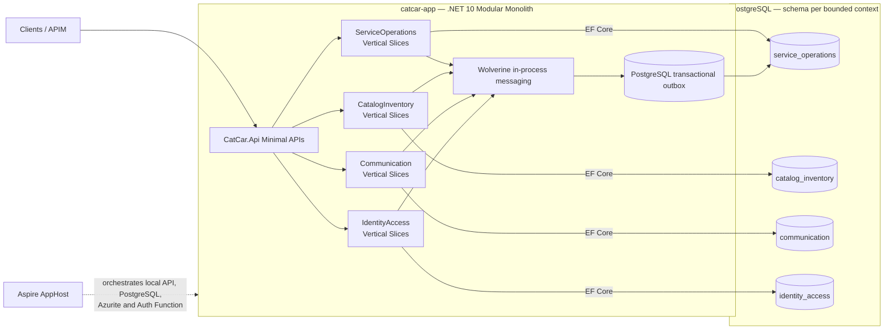

# CatCar

Back-end modular monolith for a car repair shop management system — work orders, customers, vehicles, budgets, cataloged services, parts/inventory control, and customer authentication.

## Multi-Repository Architecture

As part of Phase 3 Tech Challenge, the CatCar ecosystem is segregated into four independent repositories:

| Repository | Description | CI/CD & Deploy |
|---|---|---|
| [**`catcar-app`**](https://github.com/daviholandas/catcar-app) | Main .NET 10 Modular Monolith, Aspire AppHost & test suite | AKS Workloads via Aspire/Helm |
| [**`catcar-auth-function`**](https://github.com/daviholandas/catcar-auth-function) | Serverless Azure Function (.NET 10 Isolated) for customer CPF auth & JWT | Azure Container Apps |
| [**`catcar-kubernetes-infra`**](https://github.com/daviholandas/catcar-kubernetes-infra) | Terraform IaC: AKS, ACR, APIM, VNet, Azure Monitor Alerts & Dashboards | Terraform automated apply |
| [**`catcar-database-infra`**](https://github.com/daviholandas/catcar-database-infra) | Terraform IaC: Azure PostgreSQL Flexible Server, Key Vault & Private DNS | Terraform automated apply |

### Key Architectural Patterns
- **DDD** with 4 Bounded Contexts: ServiceOperations, CatalogInventory, Communication, IdentityAccess
- **Vertical Slice Architecture** within each Bounded Context
- **Wolverine** for in-process messaging with PostgreSQL outbox
- **EF Core** with schema-per-BC, UUID v7, optimistic concurrency via `xmin`
- **RiseOn.AutoInject** for automatic service registration
- **RiseOn.ResultRail** for the Result pattern (`Upshot<T>`)
- **.NET Aspire Orchestration**: Dual-mode AppHost for unified local development (composing `catcar-auth-function` via submodule) and production deployment.

## Dedicated Modular Monolith Architecture



The contexts retain independent domain models and EF Core schemas; vertical slices expose use cases without introducing cross-context data access. Wolverine persists integration messages in the same PostgreSQL transaction through the outbox before asynchronous delivery.

Work order approval records the customer's commercial decision but remains `AwaitingApproval` until inventory reservation is confirmed. A terminal reservation failure returns the order to diagnosis while preserving the approved budget; a new budget requires a new decision. Execution starts only on reservation confirmation. Stage averages omit unknown historical durations rather than treating them as zero.

## Prerequisites

- [.NET 10 SDK](https://dotnet.microsoft.com/download/dotnet/10.0)
- [Docker](https://www.docker.com/products/docker-desktop)
- [Azure Functions Core Tools v4.14.0+](https://learn.microsoft.com/azure/azure-functions/functions-run-local) (for local Function execution in Development mode)
- [Kind](https://kind.sigs.k8s.io/) (`v0.33+`), [kubectl](https://kubernetes.io/docs/tasks/tools/) (`v1.37+`), and [Helm](https://helm.sh/) (`v4.2+`) (for the `LocalKubernetes` cluster deployment workflow)

Clone with submodules (required for local Aspire development with AuthFunction):
```bash
git clone --recurse-submodules https://github.com/daviholandas/catcar-app.git
# or in an existing clone:
git submodule update --init --recursive
```

Restore local .NET tools (`aspire.cli`, `dotnet-ef`, `dotnet-sonarscanner`):
```bash
dotnet tool restore
```
---

## Local Workflows

CatCar provides two supported local workflows tailored for different validation goals:

### Workflow 1: Aspire AppHost (Complete Development Topology)

Runs and observes the full development architecture locally, including PostgreSQL, the API, Azurite emulator, and the customer authentication Azure Function.

```bash
# Start the full local topology
dotnet tool run aspire -- start --apphost src/Host/CatCar.AppHost/CatCar.AppHost.csproj --environment Development

# Wait for resources to become healthy
dotnet tool run aspire -- wait api --status healthy --timeout 180 --apphost src/Host/CatCar.AppHost/CatCar.AppHost.csproj
dotnet tool run aspire -- wait auth-function --status healthy --timeout 180 --apphost src/Host/CatCar.AppHost/CatCar.AppHost.csproj
```

This starts:
- **PostgreSQL**: Container with persistent volume and schema isolation (`catcar` database)
- **Azurite**: Azure Storage emulator for Functions host storage
- **CatCar API**: Modular monolith Minimal APIs listening on port 5000 (HTTP) and 5002 (HTTPS)
- **CatCar.AuthFunction**: Azure Functions Isolated Worker on port 7071 (or dynamically assigned port)
- **Aspire Dashboard**: OpenTelemetry traces, metrics, logs, and resource health

To discover dynamic ports and endpoints:

```bash
dotnet tool run aspire -- describe api --apphost src/Host/CatCar.AppHost/CatCar.AppHost.csproj
dotnet tool run aspire -- describe auth-function --apphost src/Host/CatCar.AppHost/CatCar.AppHost.csproj
```

To stop the development environment:

```bash
dotnet tool run aspire -- stop --apphost src/Host/CatCar.AppHost/CatCar.AppHost.csproj
```

---

### Workflow 2: Local Kubernetes via Kind (Kubernetes/Helm Publisher Validation)

From the platform repository root, validate the staged deployment with:

```bash
make kind-validate
```

The platform script creates or reuses the `kind-catcar` cluster, builds both images,
runs database maintenance before starting the workloads, and saves validation
evidence under `artifacts/kind/`. It requires Docker, Kind, kubectl, Helm, jq,
curl and Python 3. The local cluster and registry are retained for inspection;
remove the cluster explicitly with `kind delete cluster --name catcar` when done.
If a local port is already in use, set `API_LOCAL_PORT`, `FUNCTION_LOCAL_PORT`,
or `MAILPIT_LOCAL_PORT` (defaults: 8080, 7071, and 8025 respectively) before
running the target. Existing clusters created with the old port mapping may
already occupy port 8080.

The retained `catcar-local-runtime` Secret contains PostgreSQL credentials, independent
admin and customer HMAC signing keys, and bootstrap administrator credentials. A
pre-existing PVC without this Secret is an error, not a request to reset the database.
`LocalKubernetes` sends mail to Mailpit; the validation script forwards its UI/API to
loopback port 8025 only while running. Dirty checkout evidence is local-only and cannot
be promoted as a release.

The integrated smoke script requires `--mode kind|azure`, `API_BASE_URL`,
`AUTH_BASE_URL`, `HEALTH_BASE_URL`, `BOOTSTRAP_ADMIN_EMAIL`,
`BOOTSTRAP_ADMIN_PASSWORD`, and `SMOKE_RESULT_FILE`. Kind also requires
`MAILPIT_BASE_URL`; Azure requires `SMOKE_CUSTOMER_EMAIL`. Set the health base to the
API origin in Kind and to the APIM origin plus `/api` in Azure.

`k8s/migration-job.yaml` uses `__API_IMAGE__` for the immutable image and
`__RUNTIME_SECRET__` for the runtime Secret name. Its `catcar-migration-config`
ConfigMap supplies `DATABASE_CONNECTION_PREFIX` ending in `;` and the
`AuthReadOnly__Login` configuration; the Secret supplies PostgreSQL passwords,
the two JWT signing keys, and bootstrap credentials. Never place credentials in
the ConfigMap or publish rendered Secret values.

---

### Option 3: Docker Compose

For basic container testing without Aspire orchestration or Kubernetes:

```bash
docker compose up -d
```

Starts PostgreSQL and the CatCar API available at `http://localhost:8080`. Stop with `docker compose down`.

---

## Kubernetes & Cloud Architecture

- **Production Topology**:
  - **API Workload**: Deployed to Azure Kubernetes Service (AKS) via Helm charts generated by .NET Aspire (`aspire publish --environment Production`). Hardened with non-root security context (UID/GID 10001), read-only root filesystem, dropped capabilities, `/tmp` `emptyDir`, CPU/memory requests and limits, and `autoscaling/v2` HPA (2 to 10 replicas).
  - **Serverless Authentication**: `CatCar.AuthFunction` is published as an Azure Container App managed by Azure Container Apps Environment.
  - **Database**: Azure Database for PostgreSQL Flexible Server with private endpoints and delegated subnet isolation.
  - **Database Migrations**: Applied during startup in `Development` or executed via `k8s/migration-job.yaml` in production.

---

## Endpoints

| Endpoint | Method | Description |
|---|---|---|
| `/health/live` | `GET` | Liveness probe |
| `/health/ready` | `GET` | Readiness probe (includes PostgreSQL check) |
| `/docs` | `GET` | Scalar interactive API documentation (Development only) |
| `/openapi/v1.json` | `GET` | OpenAPI v3 JSON document |
| `/api/auth/customer` | `POST` | Customer authentication via `CatCar.AuthFunction` (`documentNumber` -> JWT Bearer) |
| `/api/v1/service-operations` | `*` | Work Orders, Budgets, Customers, Vehicles |
| `/api/v1/catalog-inventory` | `*` | Cataloged Services, Inventory Items |
| `/api/v1/communication` | `*` | Customer Notifications, Access Tokens |
| `/api/v1/identity-access` | `*` | Administrative Users, Roles, Backoffice Auth |

---

## API Documentation & Postman

For a local Development environment, use the following API references:

- **Swagger UI:** [http://localhost:5000/swagger](http://localhost:5000/swagger)
- **Scalar API Reference:** [http://localhost:5000/docs](http://localhost:5000/docs) (or [https://localhost:5002/docs](https://localhost:5002/docs))
- **OpenAPI v3 JSON:** [http://localhost:5000/openapi/v1.json](http://localhost:5000/openapi/v1.json)
- **Versioned Postman collection:** [`CatCar_Platform.postman_collection.json`](https://github.com/RiseOn-CatCar/catcar-platform/blob/main/docs/postman/CatCar_Platform.postman_collection.json)
- **Postman environment template:** [`CatCar_Platform.postman_environment.json`](https://github.com/RiseOn-CatCar/catcar-platform/blob/main/docs/postman/CatCar_Platform.postman_environment.json)

Import both Postman files, select the environment, set `baseUrl` and `apimUrl`, then obtain `customerToken` or `adminToken` through the requests in the **Authentication** folder.

---

## Project Structure

```
external/
└── catcar-auth-function/  # Pinned Git submodule for local Aspire composition

src/
├── SharedKernel/          # Tactical DDD base classes (Entity, ValueObject, etc.)
├── Contracts/             # Integration events (cross-BC contracts)
├── Contexts/
│   ├── ServiceOperations/ # Work orders, budgets, service execution
│   ├── CatalogInventory/  # Parts, inventory, stock management
│   ├── Communication/     # Notifications, customer communication
│   └── IdentityAccess/    # Authentication, authorization, user management
├── Api/                   # Composition root (Minimal APIs, Wolverine, health checks)
└── Host/
    ├── CatCar.AppHost/         # .NET Aspire AppHost (dual-mode orchestration & publish)
    └── CatCar.ServiceDefaults/ # OpenTelemetry, health checks, resilience defaults

tests/
├── SharedKernel.Tests/    # Unit tests for base classes
├── Architecture.Tests/    # NetArchTest rules (cross-BC isolation, layer purity)
├── Contexts/              # Integration tests per BC
└── E2E/                   # End-to-end Aspire orchestration tests
```
---

## Development Commands

```bash
# Build solution
dotnet build CatCar.slnx

# Run all tests
dotnet test CatCar.slnx

# Verify code formatting
dotnet format whitespace CatCar.slnx --verify-no-changes --no-restore
```

---

## CI/CD Pipeline

The GitHub Actions pipeline (`.github/workflows/ci.yml`) validates pull requests and deployments:
- **Build & Test**: Compiles solution, verifies formatting, and executes 343+ tests with OpenCover coverage.
- **Publish Model Validation**: Tests Aspire deployment model generation for both `Production` (AKS Helm chart + ACA Function) and `LocalKubernetes` (Kind Helm chart) without requiring Azure credentials.
- **Terraform Validation**: Validates `infra/kubernetes` and `infra/database` configurations.
- **Security Scans**: Opengrep SAST, NuGet vulnerability SCA, and Trivy container image scanning.

### Azure control-plane bootstrap

Before cloud deployment, follow the centralized [Azure bootstrap runbook](https://github.com/RiseOn-CatCar/catcar-platform/blob/main/docs/azure-bootstrap.md) and its root-level script.

---

## License

Proprietary — all rights reserved.
